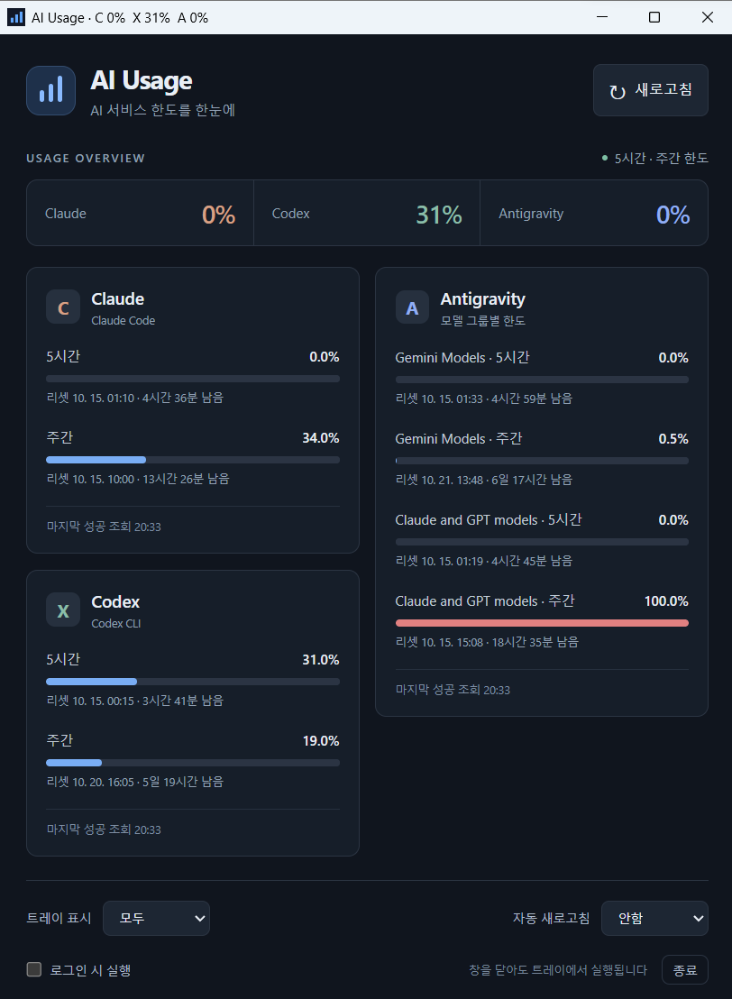

# AI Usage

**Claude, Codex, Antigravity의 사용량을 트레이와 메뉴바에서 확인하는 데스크톱 앱입니다.**

서비스별 5시간·주간 한도 사용률과 리셋까지 남은 시간을 보여줍니다. Rust + Tauri 2로 개발했으며 Windows, macOS, Linux에서 공통 코드를 사용합니다.



## 다운로드

배포 파일이 등록되어 있다면 저장소의 **Releases** 페이지에서 운영체제에 맞는 파일을 내려받으세요.

| 운영체제 | 파일 |
| --- | --- |
| Windows x64 | 설치 프로그램 `.exe` |
| macOS Intel / Apple Silicon | Universal `.dmg` 또는 `.app` |
| Linux x64 | `.deb` 또는 `.AppImage` |

Releases에 파일이 없다면 **Actions → Desktop builds → 성공한 실행 → Artifacts**에서 다운로드할 수 있습니다. 아티팩트 ZIP의 압축을 풀면 설치 파일이 들어 있습니다. Actions 빌드 결과는 Releases에 자동으로 게시되지 않습니다.

현재 Windows에서 빌드와 예시 화면 실행을 확인했습니다. macOS·Linux는 빌드 설정을 제공하며, 실제 환경에서의 실행 확인이 필요합니다. 코드 서명과 macOS 공증은 포함하지 않습니다.

## 시작하기

1. 사용할 서비스의 CLI에서 먼저 로그인합니다. Claude는 Claude Code, Codex는 Codex CLI, Antigravity는 해당 CLI의 인증 정보를 사용합니다.
2. 운영체제에 맞는 앱을 설치하고 실행합니다. macOS 앱은 `/Applications` 또는 `~/Applications`로 옮겨 주세요.
3. 트레이 아이콘 또는 메뉴바를 눌러 사용량을 확인합니다. Linux에서는 트레이 메뉴의 **사용량 보기**를 선택합니다.

Windows는 WebView2가 필요하며 설치 프로그램이 필요한 경우 설치를 진행합니다. Linux의 Antigravity 인증 조회에는 `secret-tool`과 잠금 해제된 Secret Service(예: GNOME Keyring)가 필요합니다. Ubuntu/Debian에서는 `sudo apt install libsecret-tools`로 조회 도구를 설치할 수 있습니다. AppImage도 이 도구와 인증 저장소가 필요합니다.

## 사용법

- **새로고침**으로 사용량을 바로 갱신합니다. 앱 실행 시에도 한 번 조회합니다.
- 자동 새로고침은 **안함 / 10분 / 1시간** 중 선택하며 기본값은 안함입니다. 창을 닫거나 최소화해도 설정한 간격으로 조회합니다.
- 표시할 서비스를 선택하고 **로그인 시 실행**을 설정할 수 있습니다. 자동 실행은 설치한 앱에서 설정하는 것을 권장합니다.
- Windows·macOS에서 창을 닫으면 트레이에서 계속 실행됩니다. Linux에서는 다시 열 수 있도록 창을 최소화합니다. 완전히 종료하려면 창 또는 트레이 메뉴의 **종료**를 선택합니다.

`C 24%  X 37%  A 25%`에서 **C = Claude, X = Codex, A = Antigravity**입니다. 수치는 토큰 개수가 아닌 **서비스 한도 사용률**입니다. macOS는 메뉴바에, Windows는 트레이 툴팁과 창 제목에 표시합니다.

| 표시 | 의미 |
| --- | --- |
| `—` | 아직 조회한 값이 없음 |
| `!` | 조회 실패 |
| `*` | 갱신에 실패하여 이전 성공 값을 표시 중 |

Antigravity는 5시간 모델 그룹 중 가장 높은 사용률을 대표 값으로 표시합니다. 5시간 정보가 없으면 주간 정보를 사용합니다.

Linux의 트레이 표시는 데스크톱 환경에 따라 다르며 GNOME에서는 AppIndicator 확장이 필요할 수 있습니다. 트레이가 없는 환경에서도 창에 접근할 수 있도록 Linux에서는 백그라운드 시작 시에도 창을 표시합니다.

## 인증과 데이터

앱에서 별도로 로그인하지 않고 CLI에 저장된 인증 정보를 읽습니다.

| 서비스 | Windows | macOS | Linux |
| --- | --- | --- | --- |
| Claude | `~/.claude/.credentials.json` | 키체인 `Claude Code-credentials`, 없으면 인증 파일 | `~/.claude/.credentials.json` |
| Codex | `~/.codex/auth.json` | `~/.codex/auth.json` | `~/.codex/auth.json` |
| Antigravity | 자격 증명 관리자 `gemini:antigravity` 또는 `gemini:antigravity-acp` | 키체인 서비스 `gemini`, 계정 `antigravity` 또는 `antigravity-acp` | Secret Service의 `service=gemini`, `username=antigravity` 또는 `antigravity-acp` |

`~`는 현재 사용자의 홈 폴더입니다. macOS에서 키체인 접근을 요청하면 허용해 주세요.

- Claude 인증 디렉터리는 `CLAUDE_CONFIG_DIR`, Codex 인증 디렉터리는 `CODEX_HOME`으로 지정할 수 있습니다. macOS에서 `CLAUDE_CONFIG_DIR`을 지정하면 키체인 대신 해당 디렉터리의 인증 파일을 읽습니다.
- Codex는 ChatGPT 계정 로그인 토큰이 필요합니다. API 키 전용 인증과 Windows에서 WSL 내부 인증은 자동으로 지원하지 않습니다.
- Antigravity 저장 방식이 다른 경우 `AI_USAGE_ANTIGRAVITY_AUTH`에 기존 CLI 인증 JSON 파일 경로를 지정할 수 있습니다. 이 파일은 시스템 인증 저장소보다 우선합니다. JSON 최상위 또는 `token` 객체에 `access_token`을 사용하며, 갱신하려면 `refresh_token`, `client_id`와 필요한 경우 `client_secret`, `expiry` 또는 `expires_at`이 있어야 합니다.

인증이 만료되면 해당 CLI에서 다시 로그인한 뒤 새로고침하세요. Antigravity는 필요한 정보가 있으면 토큰을 메모리에서 갱신하며, 갱신할 수 없으면 `agy models` 실행을 안내합니다. GUI로 실행한 앱은 터미널에서 설정한 환경 변수를 상속하지 않을 수 있습니다.

인증 저장소에는 쓰지 않습니다. 인증 정보와 HTTP 응답은 화면·로그·별도 파일에 저장하지 않으며, 사용량 캐시는 메모리에만 유지합니다. 새로고침 간격과 표시 서비스 설정은 운영체제의 앱 데이터 폴더에 저장합니다.

각 서비스의 내부 API를 사용하므로 API 또는 CLI 인증 형식이 바뀌면 업데이트가 필요할 수 있습니다.

## 소스에서 실행하기

Node.js LTS와 운영체제별 개발 도구가 필요합니다. 설치 스크립트는 Rust를 프로젝트의 `.tools/`에, Tauri CLI를 `node_modules/`에 설치하며 시스템 PATH는 변경하지 않습니다. 자세한 시스템 요구 사항은 [Tauri 공식 문서](https://v2.tauri.app/start/prerequisites/)를 참고하세요.

### Windows

Visual Studio Build Tools의 **C++ 데스크톱 개발**, Windows SDK와 WebView2를 준비한 뒤 프로젝트 폴더의 PowerShell에서 실행합니다.

```powershell
powershell -NoProfile -ExecutionPolicy Bypass -File ./scripts/setup.ps1
npm run dev
```

### macOS

```sh
xcode-select --install
# Command Line Tools 설치가 끝난 뒤 프로젝트 폴더에서 실행
sh scripts/setup.sh
npm run dev
```

macOS 빌드의 최소 버전 설정은 10.15입니다. 기본 빌드는 현재 Mac의 아키텍처를 사용합니다.

### Linux (Ubuntu/Debian)

```sh
sudo apt update
sudo apt install libwebkit2gtk-4.1-dev build-essential curl wget file \
  libxdo-dev libssl-dev libayatana-appindicator3-dev librsvg2-dev \
  pkg-config libsecret-tools
sh scripts/setup.sh
npm run dev
```

CI는 Ubuntu 22.04 x64를 기준으로 빌드합니다. 다른 배포판은 해당 배포판의 Tauri 개발 패키지를 설치해야 합니다.

### 빌드와 테스트

```sh
npm test
npm run test:rust
npm run check
npm run fmt -- --check
npm run build
```

빌드한 설치 파일은 `src-tauri/target/release/bundle/`에 생성됩니다. `--target`을 지정하면 `src-tauri/target/<target>/release/bundle/`에 생성됩니다.

macOS Universal 앱을 만들려면 두 아키텍처의 Rust 타깃을 설치한 뒤 빌드합니다.

```sh
export CARGO_HOME="$PWD/.tools/cargo"
export RUSTUP_HOME="$PWD/.tools/rustup"
export PATH="$CARGO_HOME/bin:$PATH"
rustup target add aarch64-apple-darwin x86_64-apple-darwin
npm run build -- --target universal-apple-darwin
```

`.github/workflows/build.yml`은 push, pull request 및 수동 실행 시 Windows·macOS Universal·Linux x64에서 테스트와 패키징을 수행하고 결과물을 Artifacts에 저장합니다.

### 예시 화면

실제 인증 없이 화면을 확인하려면 다음 명령을 실행합니다.

```sh
npm run demo
# 브라우저에서 http://127.0.0.1:1420/?demo=1 접속
```

네이티브 앱의 예시 모드는 `npm run dev:demo`로 실행합니다. 예시 모드에서는 실제 인증을 조회하지 않으며 자동 실행 설정을 변경할 수 없습니다.
